<p align="center">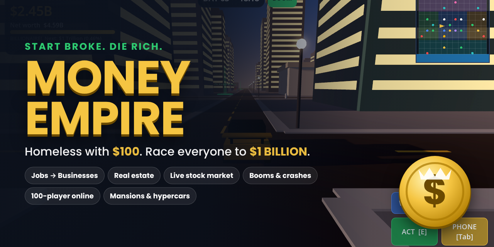</p>

<h1 align="center">💰 Money Empire</h1>
<p align="center"><b>Start homeless with $100. Work, build, flip, trade, invest — and race everyone to $1&nbsp;Billion.</b><br>
A 3D multiplayer money sim built in <b>Godot 4</b> for PC, browser and Android.</p>

<p align="center">
  <a href="https://jaineil32624.github.io/money-empire/play/"><b>▶ Play in your browser</b></a> ·
  <a href="https://github.com/jaineil32624/money-empire/releases/latest/download/MoneyEmpire.apk"><b>📱 Android APK</b></a> ·
  <a href="https://github.com/jaineil32624/money-empire/releases/latest/download/MoneyEmpire.exe"><b>🪟 Windows</b></a> ·
  <a href="https://github.com/jaineil32624/money-empire/releases/latest/download/MoneyEmpire.x86_64"><b>🐧 Linux</b></a> ·
  <a href="https://jaineil32624.github.io/money-empire/"><b>🌐 Website</b></a>
</p>

<p align="center">
  
  
  
  
  <a href="https://github.com/jaineil32624/money-empire/actions"></a>
  
</p>

---

## 🎮 What is it?

You wake up on a downtown sidewalk with **$100**, no car and no home. Everything in the city revolves around money — and every other tycoon (AI rivals offline, real players online) wants to reach **$1,000,000,000** before you do.

**Hustle** with real 3D jobs → **own** businesses that pay you every hour → **expand** into real estate and the stock market → **dominate** with malls, banks and a space company → leave a **legacy**: your own skyscraper, a rocket launch, a private island. Then race for the first **trillion**.

<p align="center">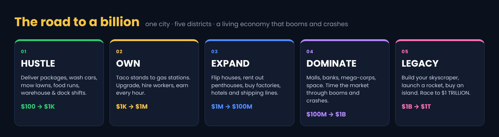</p>

## 📸 Screenshots

| Day 1 — your first job | Billionaire in a hypercar |
|---|---|
| 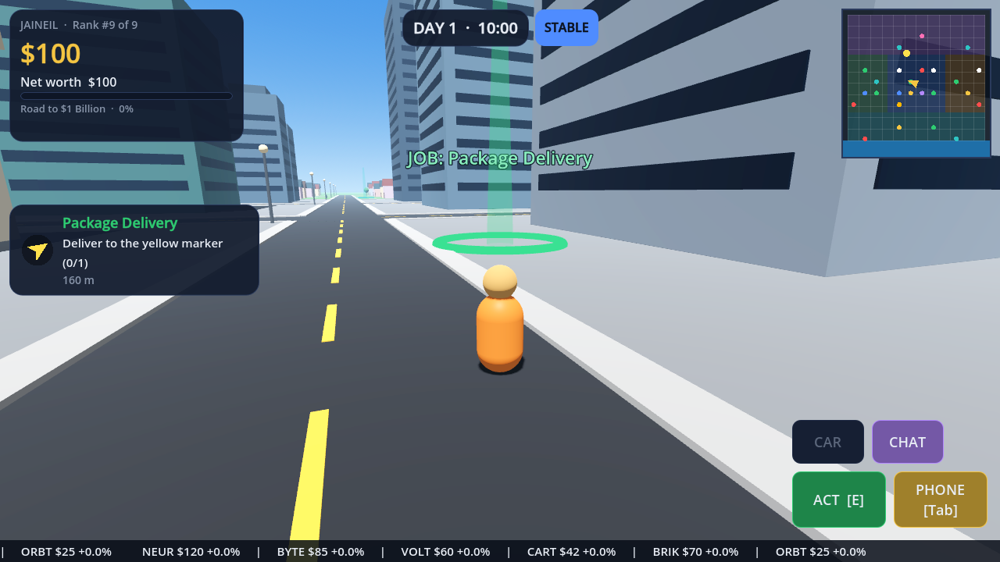 | 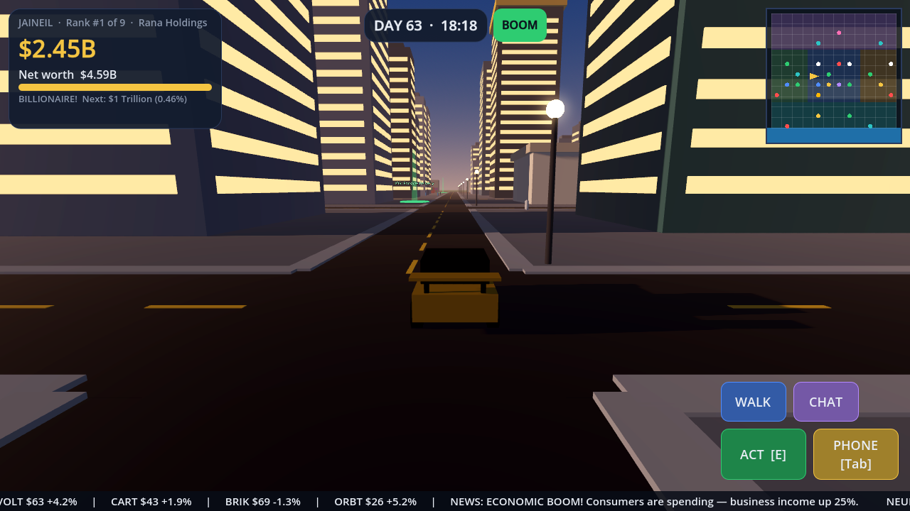 |
| **Your mansion (pool, helipad, garage)** | **Night flight over the harbor** |
| 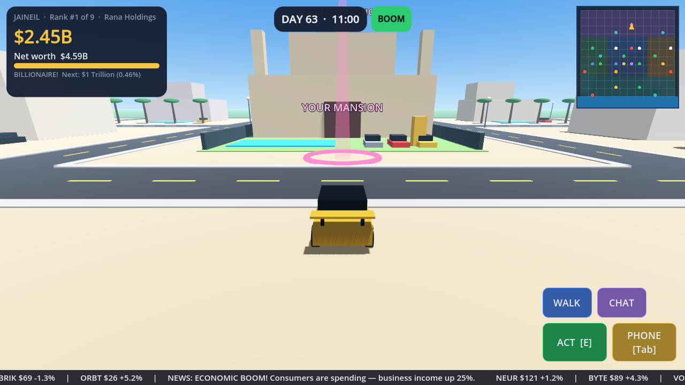 | 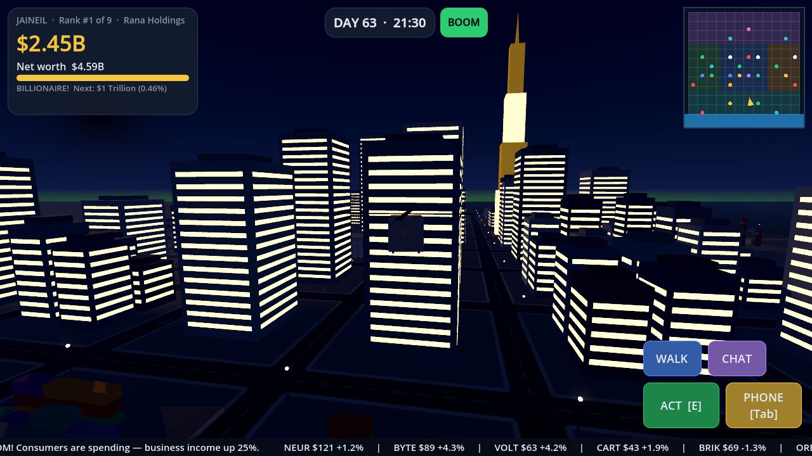 |
| **Endgame: your Empire Tower** | **The Harbor** |
| 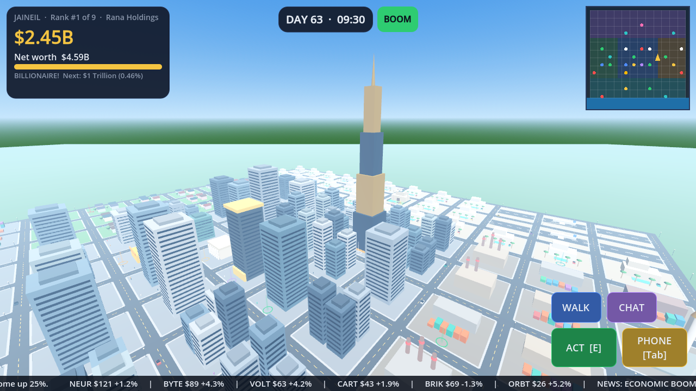 | 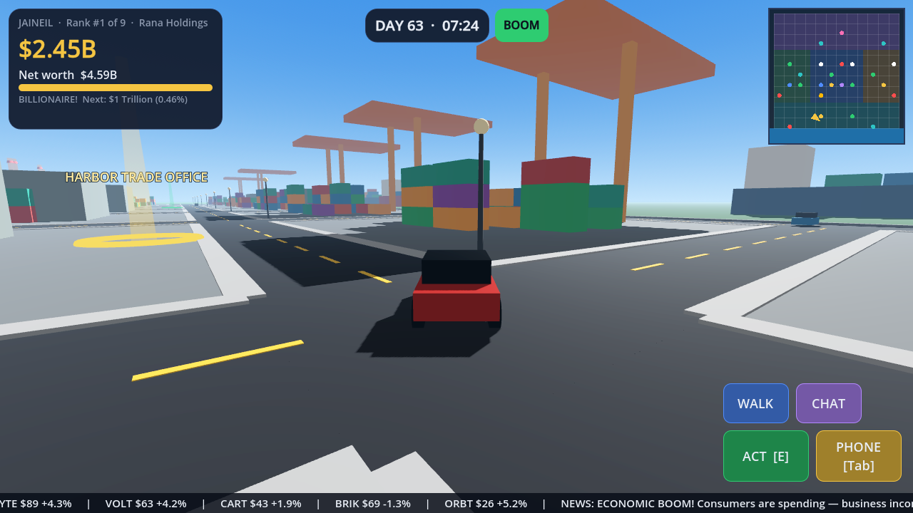 |
| **Business empire** | **Live stock market** |
| 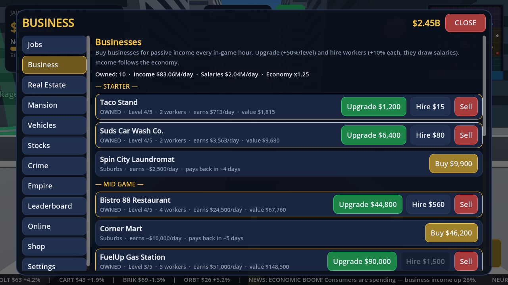 | 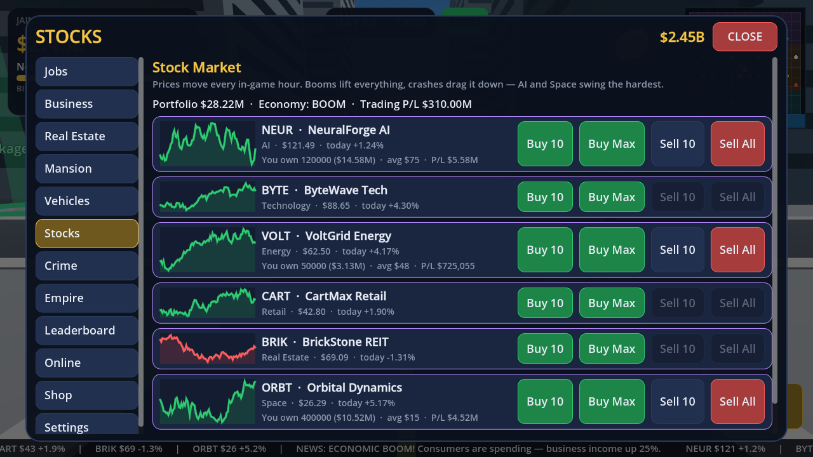 |
| **Real estate & flipping** | **Leaderboard** |
| 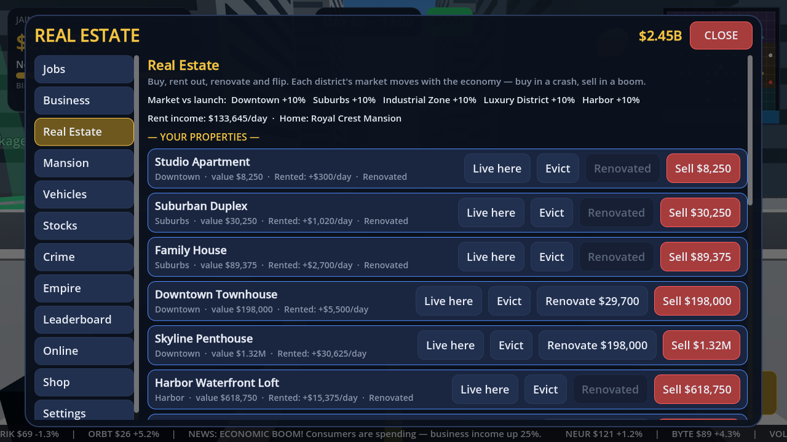 | 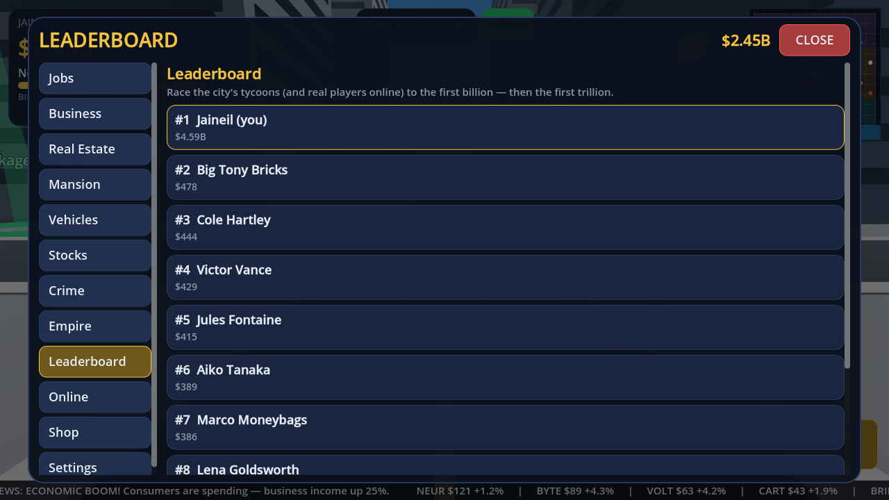 |

<sub>All screenshots are real captures from the Godot build (`godot --path . -- --tour=docs/screenshots`).</sub>

## ✨ Features

### 💼 Ways to earn
| Stage | What you do |
|---|---|
| 🟢 **Starter jobs** | Package delivery, car wash, lawn mowing, timed food delivery (tips for speed), warehouse shifts, dock hand — real missions with GPS markers |
| 🟡 **Mid game** | Taco stand, car wash company, laundromat, restaurant, corner store, gas station |
| 🔵 **Big league** | Car dealership, hotel, factory, shipping company · flip houses, rent out penthouses |
| 🟣 **Tycoon** | Shopping mall, luxury resort, bank, investment firm |
| 🌸 **Mega empire** | OmniCorp mega-corporation, Starforge Aerospace |

Every business levels up to **5** and takes up to **5 workers** (+10% income each, paid salaries).

### 🏙️ One big city, five districts
**Downtown** (towers, Stock Exchange, City Hall) · **Suburbs** (houses, small businesses) · **Industrial Zone** (factories, warehouses, the spaceport) · **Luxury District** (mansions, supercars, private airport) · **Harbor** (cargo ships, cranes, imports). Day/night cycle, traffic, pedestrians, lit windows at night.

### 📈 A real, living economy
- **Boom → Stable → Recession → Market Crash** cycles that change income, property values and stock prices
- **Inflation** across a 60-day game year
- **Per-district property markets** — buy in a crash, sell in a boom
- **Stock market:** NeuralForge AI, ByteWave Tech, VoltGrid Energy, CartMax Retail, BrickStone REIT, Orbital Dynamics — hourly prices, company news, charts

### 🏠 Real estate & mansions
Buy, rent out, renovate (+25% value), flip, move in (+10% job pay). Mansions get an infinity pool, home theater, trophy room, 10-car garage, security system and helipad — built on your lot in the Luxury District, with your cars parked out front. Friends can visit online.

### 🚗 Vehicles
City bike → scooter → sedan → SUV → Velocity GT → **Hypercar X1** → **helicopter** (flies over traffic) → **superyacht** & **private jet** (fast travel).

### 🚨 Crime (optional)
Corner store robbery, phone scams, harbor smuggling, the Monolith Bank heist. Massive payouts — but **heat** raises the odds of getting caught: fines, jail time and **property seizure**. You can win without ever committing a crime.

### 🏆 Endgame
At $1B: **build your skyscraper**, **launch a rocket**, **IPO your corporation**, raise a **golden statue** — all appear in the city. Then chase **$1 Trillion**.

### 🌐 Multiplayer (up to 100 players)
- Host, join by IP, or run a **headless dedicated server**
- **Shared economy:** everyone lives through the same boom and crash, same stock prices, same clock
- Text chat, **send money**, **corporations** (teams) with a corporate leaderboard
- Server-side **anti-cheat** on net worth growth and transfers · details in [docs/MULTIPLAYER.md](docs/MULTIPLAYER.md)

### 🎨 Cosmetics, not pay-to-win
Empire Coins (earned in-game), daily reward, a 30-tier **Season Pass** (free + premium tracks), character skins, car paints, mansion decor. Nothing purchasable changes money, speed or rank — a unit test enforces it. See [docs/MONETIZATION.md](docs/MONETIZATION.md).

### 🕹️ Controls
| | Keyboard & mouse | Gamepad | Touch |
|---|---|---|---|
| Move / run | WASD · Shift | Left stick · RB | Joystick · RUN |
| Look | Drag mouse · wheel zoom | Right stick | Drag right side · pinch |
| Interact | E | A | ACT |
| Phone (all menus) | Tab / M | Y | PHONE |
| Vehicle | V | X | CAR |
| Chat | T | Back | CHAT |

## 🧩 Godot integration

Plain **Godot 4.3** project, **GL Compatibility** renderer, no plugins, **no imported assets** — the city, vehicles, UI and even the music are generated in GDScript at runtime.

```
scripts/core/catalog.gd      ← every price, income and risk in the game
scripts/core/empire_sim.gd   ← the whole economy as pure logic (game, server and tests share it)
scripts/core/economy.gd      ← boom / recession / crash, inflation, property markets
scripts/core/stock_market.gd ← hourly stock prices + company news
scripts/net/net.gd           ← ENet multiplayer, chat, trades, anti-cheat, dedicated server
scripts/world/               ← procedural city, player & vehicles, job missions
scripts/ui/                  ← HUD, phone, title screen
tests/                       ← 418 unit tests + a balance bot that must reach $1B
```

**Open:** Godot 4.3 → Import → `project.godot` → F5. Full guide: **[docs/GODOT.md](docs/GODOT.md)**.

```bash
godot --headless --path . -s tests/run_tests.gd    # 418 unit tests
godot --headless --path . -s tests/smoke_sim.gd    # balance bot: $100 → $1B
godot --headless --path . -- --server              # dedicated server on UDP 7777
```

## 📦 Builds & CI

Every push to `main` runs the tests, exports **Android APK, Windows, Linux, Web and the dedicated server**, publishes them to [Releases](https://github.com/jaineil32624/money-empire/releases), and deploys the [website](https://jaineil32624.github.io/money-empire/) with the browser build at `/play/`.

Publishing to stores: [docs/STEAM.md](docs/STEAM.md) (Steam, consoles, Google Play, iOS).

## 🗺️ Roadmap
- [ ] **VR mode** (OpenXR) — walk your mansion and trading floor in VR
- [ ] Voice chat (Steam Voice / WebRTC proximity audio)
- [ ] Server-side wallets for ranked public servers
- [ ] WebSocket transport so the browser build can play online
- [ ] Steamworks: achievements, lobbies, cloud saves
- [ ] Hired NPC workers visible inside businesses
- [ ] Building interiors (trading floor, casino, nightclub)
- [ ] Seasonal events (Market Mayhem, Housing Boom, Billionaire Sprint)

## 📄 License
[MIT](LICENSE) © 2026 Jaineil Rana. All company names in the game are fictional.
